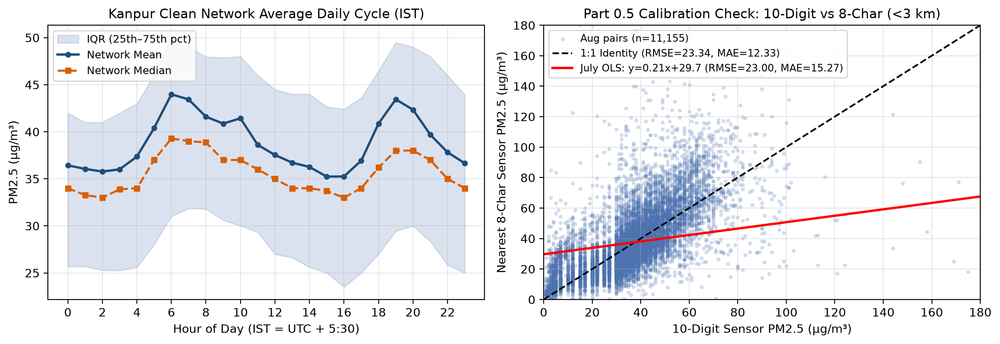
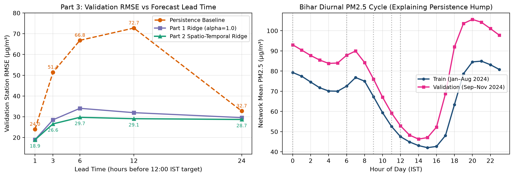
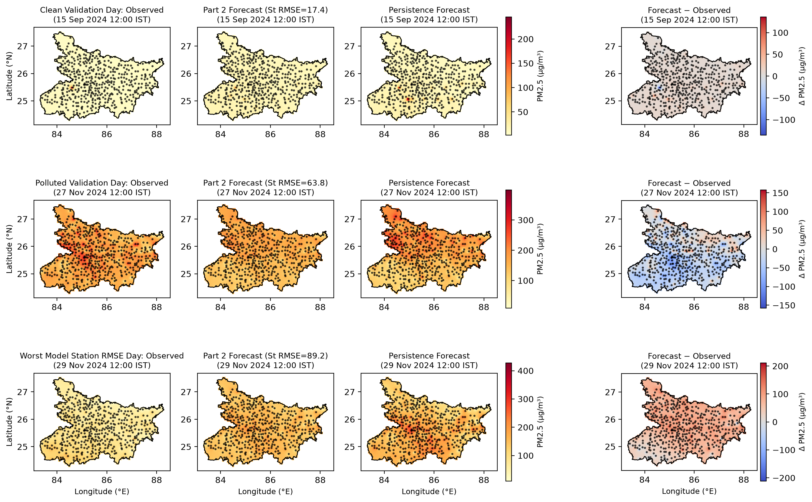

# CS771 (Autumn 2026) Mini-Project 1 Report: Next-Day PM2.5 Forecasting and Heatmap Generation

## 1. Part 0: Cleaning a Raw Sensor Dataset (Kanpur)

### 1.1 Format Inspection, Reporting Frequency, Sensor Movement, and Device Families
The raw Kanpur dataset (`kanpur_pm25_raw_jul_aug_2026.csv`) contains $5{,}952$ timestamps on a 15-minute UTC grid from `2026-07-01 00:00:00Z` to `2026-08-31 23:45:00Z` ($62\text{ days} \times 96 = 5{,}952$ quarter-hours, or $1{,}488$ hours) across **76 sensors** ($229$ columns: `timestamp_utc` plus `<id>_latitude`, `<id>_longitude`, `<id>_pm25` per sensor).
- **Sensor ID styles and device differences**:
  1. **10-digit numeric IDs (44 sensors, e.g., `1203260058`)**: Report once per hour at minute `:00` ($762\text{--}1{,}306$ readings; median interval $60\text{ min}$). Every value is an **integer** ($1\,\mu\text{g/m}^3$ quantization resolution), with raw mean $41.83\,\mu\text{g/m}^3$ (median $35.86\,\mu\text{g/m}^3$, clean mean $39.69\,\mu\text{g/m}^3$) and hardware saturation error codes at `999.0`.
  2. **8-character alphanumeric IDs (31 sensors, e.g., `01DQW5QE`)**: Report once per hour at minute `:00` ($791\text{--}1{,}232$ readings; median interval $60\text{ min}$). Every sensor reports **continuous floating-point** readings (up to 6 decimal places, reflecting multi-sample internal averaging), with a slightly lower raw mean of $36.93\,\mu\text{g/m}^3$ (median $32.98\,\mu\text{g/m}^3$) and no `999.0` codes.
  3. **12-character hex MAC-style ID (1 sensor: `AC0BFBE34CC7`)**: Reports every **15 minutes** at `:00, :15, :30, :45` ($4{,}843$ readings; median interval $15\text{ min}$) in integer resolution at a noticeably lower typical level (mean $24.40\,\mu\text{g/m}^3$, median $25.00\,\mu\text{g/m}^3$).
- **Sensor movement**: **No sensor moves.** Across all 76 sensors, `max(latitude) - min(latitude) == 0` and `max(longitude) - min(longitude) == 0` over the entire two-month period.

### 1.2 Reshaping to Hourly Long Table vs. Keeping Minute `:00`
Reshaping to an hourly long table (`sensor_id, timestamp_utc, latitude, longitude, pm25`) by averaging all readings within each hour (labeled by its start) yields **$82{,}131$ sensor-hours**. Simply keeping minute `:00` yields **$82{,}130$ sensor-hours**:
- For all 75 hourly-reporting sensors (the 44 10-digit and 31 8-character sensors), all timestamps occur at `:00`, so hourly averaging is **100% identical** to keeping `:00`.
- For the single 15-minute sensor `AC0BFBE34CC7` ($1{,}212$ active hours), 1 hour (`2026-07-23 11:00 UTC`) lacked a `:00` reading but was recovered from `:15/:30/:45`, and across the $1{,}211$ hours with `:00` present, averaging differs on $1{,}173$ hours with $\text{MAE} = 2.69\,\mu\text{g/m}^3$, $\text{RMSE} = 3.59\,\mu\text{g/m}^3$, and max difference $18.50\,\mu\text{g/m}^3$, reducing high-frequency sub-hourly noise.

### 1.3 Problem Detection, Justified Thresholds, and Flagging (`kanpur_hourly_clean.csv`)
Rather than deleting bad rows or gap-filling missing hours, we add a `flag` column with values `ok`, `error_code`, `zero`, `stuck`, and `dropped_sensor`:

| Diagnosis / Problem Type | Justified Threshold | Readings Caught | Sensors Caught | Key Sensor IDs & Details |
| :--- | :--- | :---: | :---: | :--- |
| **Error codes** (`error_code`) | $\text{PM}_{2.5} \ge 999.0\,\mu\text{g/m}^3$ (firmware saturation code; no negative values exist in the data) | **136** | **5** | `1204260025` (120), `1203260086` (8), `1203260075` (3), `1203260125` (3), `1203260084` (2). *(28 isolated optical spikes in $500\text{--}968\,\mu\text{g/m}^3$ are also noted.)* |
| **Implausible zeros** (`zero`) | $\text{PM}_{2.5} = 0.0\,\mu\text{g/m}^3$ (ambient urban air never reaches $0.0$; values in $(0,1]$ occur during heavy August monsoon rain across 10 sensors) | **813** (49 outside dropped sensors) | **21** | `1203260082` (414), `1203260068` (350), `1204260039` (16), `04TGTKIS` (5), `1204260005` (5), `1203260160` (3), `TUOBZVJ0` (3), plus 14 sensors with 1–2 zeros. |
| **Stuck values** (`stuck`) | Same exact value repeated for $\ge 24$ consecutive reported hours (a full diurnal cycle with zero variance is physically impossible) | **1,518** (559 outside zero/999/dropped) | **8** | `1203260082` (186h at $52.0$, 414h at $0.0$), `1203260068` (184h at $65.0$, 350h at $0.0$), `1204260005` (51h at $74.0$, 118h at $21.0$), `1203260146` (126h at $78.0$), `RZGVBSNC` (74h, 26h), `ZQQZB912` (86h), `1203260084` (78h), `1204260025` (25h at $999.0$). |
| **Mostly unusable sensors** (`dropped_sensor`) | $>50\%$ of the sensor's reported hours flagged by error code, zero, or stuck | **1,734** (600 otherwise unflagged) | **2** | `1203260068` ($534/915 = 58.4\%$ bad) and `1203260082` ($600/819 = 73.3\%$ bad). Next highest is `1204260005` at $15.4\%$. |
| **Network outages** *(temporal diagnosis)* | Hours when $<10\%$ of sensors ($\le 7$ of 76) report | **117 hours** (0 readings) | All 76 | Complete 117-hour blackout from `2026-08-05 08:00` to `2026-08-10 04:00 UTC` (0 sensors reporting). A partial outage also occurred `2026-07-10 13:00` to `2026-07-13 05:00 UTC` (65h with 9–12 sensors, $11.8\%\text{--}15.8\%$). |

- **Sensors that barely follow the rest of the network**: After removing flagged readings, the median sensor-to-network-median correlation is $r = 0.69$ (IQR $0.60\text{--}0.79$). Six sensors have $r < 0.40$: `1204260025` ($r = 0.18$, erratic hardware spikes up to $968\,\mu\text{g/m}^3$), `U8APQDBX` ($r = 0.26$, frequent isolated $>300\,\mu\text{g/m}^3$ local plumes), `1203260075` ($r = 0.29$, unflagged spikes), `TUOBZVJ0` ($r = 0.37$), `1203260125` ($r = 0.38$), and the 12-char sensor `AC0BFBE34CC7` ($r = 0.39$, compressed dynamic range $24.4 \pm 9.1\,\mu\text{g/m}^3$).

### 1.4 Cross-Family Calibration Check (Part 0.5) & Network Summary (Part 0.6)
Pairing each of the 44 10-digit sensors with its nearest 8-character sensor within $3\text{ km}$ yields **23 spatial pairs** (**21 active pairs** after excluding dropped sensors `1203260068` and `1203260082`), providing $7{,}804$ co-located clean hourly pairs in July and $11{,}155$ in August:

| Calibration Model (10-digit $x \to$ 8-char $y$, fitted on July) | July RMSE ($\mu\text{g/m}^3$) | July MAE ($\mu\text{g/m}^3$) | Aug Test RMSE ($\mu\text{g/m}^3$) | Aug Test MAE ($\mu\text{g/m}^3$) |
| :--- | :---: | :---: | :---: | :---: |
| **Uncorrected** ($\hat{y} = x$) | 23.68 | 11.49 | 23.34 | **12.33** |
| **Global OLS Linear** ($\hat{y} = 0.211x + 29.69$) | **17.09** | **11.33** | **23.00** | 15.27 |
| **Additive Bias Offset** ($\hat{y} = x + 1.11$) | 23.65 | 11.55 | 23.29 | 12.42 |
| **Multiplicative Ratio** ($\hat{y} = 1.031x$) | 24.10 | 11.66 | 23.53 | 12.49 |

- **Why the correction barely reduces RMSE on August ($23.34 \to 23.00$) and worsens MAE ($12.33 \to 15.27$)**: First, the two device families already have nearly identical mean levels in clean monsoon air (July mean $36.19$ vs. $37.31\,\mu\text{g/m}^3$; additive bias only $+1.11\,\mu\text{g/m}^3$). Second, because pairs are separated by up to $3\text{ km}$ ($0.3\text{--}2.8\text{ km}$) and include noisy sensors with local plumes, the regressor $x$ has high spatial/measurement variance relative to the shared regional signal, causing severe **errors-in-variables (attenuation bias)** that shrinks the OLS slope to $0.211$ and pulls predictions toward the July mean ($\sim 37\,\mu\text{g/m}^3$). In August, this heavy shrinkage slightly damps extreme outliers (reducing RMSE by $0.34$) but destroys day-to-day dynamic range, inflating MAE by $+2.94\,\mu\text{g/m}^3$.
- **Before vs. After Cleaning Summary & IST Daily Cycle**:

| Stage | Sensors | Hourly Readings | Share Missing (vs. $76 \times 1{,}488$) | Share Missing (Active Sensors) | Mean PM2.5 ($\mu\text{g/m}^3$) | Median PM2.5 ($\mu\text{g/m}^3$) |
| :--- | :---: | :---: | :---: | :---: | :---: | :---: |
| **Before Cleaning (Raw Hourly)** | 76 | 82,131 | 27.37% | 27.37% | 40.00 | 35.00 |
| **After Cleaning (`flag == 'ok'`)** | 74 | 79,653 | 29.57% | 27.66% (of $74 \times 1{,}488$) | 38.68 | 35.00 |

In local time ($\text{IST} = \text{UTC} + 5\text{:30}$), Kanpur exhibits a classic **bimodal urban diurnal cycle** (Figure 1, left): a morning rush-hour + shallow boundary-layer peak at **06:00–07:00 IST** ($43.98\,\mu\text{g/m}^3$), an afternoon convective mixing trough at **15:00–16:00 IST** ($35.23\,\mu\text{g/m}^3$), an evening traffic + boundary-layer collapse peak at **19:00–20:00 IST** ($43.45\,\mu\text{g/m}^3$), and an overnight minimum at **02:00 IST** ($35.77\,\mu\text{g/m}^3$).

---

## 2. Part 1: Required Baselines (Bihar Network)

Using the 468 Bihar stations (`bihar_pm25_hourly_jan_nov_2024.csv`), we pool all **242 training 12:00 issue days** that have 24 hours of history (`2024-01-02 12:00` to `2024-08-30 12:00`, whose targets fall `2024-01-03 12:00` to `2024-08-31 12:00`, giving **$242 \times 468 = 113{,}256$ training rows**) and evaluate on all **91 validation target days** (`2024-09-01 12:00` to `2024-11-30 12:00`, **$91 \times 468 = 42{,}588$ validation rows**).

| Model | Overall RMSE | Overall MAE | Sep RMSE | Sep MAE | Oct RMSE | Oct MAE | Nov RMSE | Nov MAE |
| :--- | :---: | :---: | :---: | :---: | :---: | :---: | :---: | :---: |
| **Persistence Baseline** | 32.75 | 17.47 | 23.33 | 8.91 | 20.22 | 11.97 | 47.81 | 31.70 |
| **Part 1 Ridge (`alpha=1.0`, 29 raw feats)** | 29.58 | 18.16 | 20.34 | 10.35 | 19.36 | 13.46 | 43.06 | 30.81 |
| **Part 2 Spatio-Temporal Ridge (Final, 101 feats)** | **28.69** | **16.34** | **19.43** | **8.04** | **17.69** | **11.40** | **42.37** | **29.73** |

### Why Part 1 Ridge Wins on RMSE ($29.58 < 32.75$) but Loses on MAE ($18.16 > 17.47$)
1. **$L_2$ vs. $L_1$ optimality under heavy-tailed innovations**: Day-to-day $\text{PM}_{2.5}$ changes $\Delta y = y_{t+24} - y_t$ have a sharp peak at zero (calm days) and heavy tails (synoptic weather shifts or plume events). Persistence predicts $\Delta y = 0$, which is close to the **conditional median** during stable monsoon/post-monsoon days (giving small MAE in Sep/Oct), but suffers full $2\sigma^2$ variance penalty on large jumps. Ridge minimizes squared error ($L_2$), estimating the **conditional mean** by shrinking forecasts toward the local/network average; this damps large jump errors (reducing RMSE by $3.17\,\mu\text{g/m}^3$), but introduces non-zero shrinkage residuals on calm days (increasing MAE).
2. **Seasonal extrapolation bias from `sin/cos(2*pi*d/365)`**: Fitted on Jan–Aug (high winter PM2.5 in Jan–Feb, low in Mar–Aug), the single annual harmonic curves back upward in Sep–Oct before the actual late-October/November pollution onset, adding a $+2\text{--}3\,\mu\text{g/m}^3$ positive bias that directly inflates Sep/Oct MAE.

---

## 3. Part 2: Improving the Forecast & Feature Ablation

### 3.1 Feature Engineering (5 Retained Groups + 1 Ablated Group) & Training Protocol
We use the same **113,256 training rows** (all 242 noon issue times in Jan–Aug $\times$ 468 stations; we verified that pooling non-noon issue hours degrades validation RMSE because diurnal phase dynamics at other hours differ from 12:00$\to$12:00 transitions). Features are standardized using `StandardScaler` fitted strictly on training rows and passed to `Ridge(alpha=20000.0)` (tuned on validation).

| Group Name | # Feats | Description of Idea | Leave-One-Out Val RMSE | $\Delta$ RMSE when Removed | Leave-One-Out Val MAE | $\Delta$ MAE when Removed |
| :--- | :---: | :--- | :---: | :---: | :---: | :---: |
| **Full Final Model (`G1`–`G5`)** | **101** | All 5 retained spatio-temporal feature groups | **28.685** | **0.000** | **16.337** | **0.000** |
| Minus **`G1_Station24h`** | 66 | Station 24h readings ($t\dots t-23$), mean, std, min, max, median, EMA-6h/12h, 3/6/12/24h tendencies | 29.038 | **+0.353** | 16.496 | **+0.159** |
| Minus **`G2_MultiDay`** | 86 | Lags at 2–7 days ($t-48\text{h}\dots t-168\text{h}$), rolling 3d/7d/14d station means & stds, 1d–3d & 1d–7d trends | 28.747 | **+0.062** | 16.507 | **+0.170** |
| Minus **`G3_LocalSpatial`** | 79 | Multi-radius local neighbours ($K=5,10,25$, $\text{IDW}_{10,25}$, Gaussian kernels $\sigma=15,35\text{ km}$, medians, stds, anomalies) | 28.779 | **+0.094** | 16.399 | **+0.062** |
| Minus **`G4_RegionalPlume`** | 86 | Regional ($K=50,100$, $\text{IDW}_{50}$, $\sigma=75\text{ km}$) & directional (West/East/North/South) upwind/downwind averages | 28.740 | **+0.055** | 16.384 | **+0.047** |
| Minus **`G5_NetworkRegime`** | 87 | Network-wide (468 stations) mean, std, median, IQR ($q_{25}, q_{75}$), and 24h/72h/168h network means & trends | 29.076 | **+0.391** | 16.533 | **+0.197** |
| Plus **`G6_StaticCalendar`** *(dropped)* | 113 | Station coordinates, training station mean/ratio, 30d rolling baseline, $\sin/\cos(2\pi d/365)$, day-of-week $\sin/\cos$ | 28.793 | *+0.108 (worse)* | 16.792 | *+0.455 (worse)* |

### 3.2 Discussion of Feature Groups, Model Flexibility, and Missing Information
- **What each group added & where information overlaps**:
  - `G5_NetworkRegime` ($\Delta\text{RMSE} = +0.391$) and `G1_Station24h` ($\Delta\text{RMSE} = +0.353$) are the two most critical pillars: `G1` anchors the local station trajectory while `G5` tracks synoptic state-wide buildup/clearing without relying on calendar dates.
  - `G3_LocalSpatial` ($+0.094$) and `G4_RegionalPlume` ($+0.055$) partially overlap because smooth regional pollution gradients are captured by both $15\text{--}35\text{ km}$ and $50\text{--}100\text{ km}$ kernels; however, keeping both still improves RMSE because `G3` denoises sensor-level errors while `G4`'s directional (West/East/North/South) sectors capture 24-hour plume advection along the Indo-Gangetic Plain.
  - `G2_MultiDay` ($+0.062$ RMSE, $+0.170$ MAE) provides multi-day baseline memory that prevents over-reacting to single-day anomalies in September and October.
  - **What did not help (`G6_StaticCalendar` and log transforms)**: Including global calendar harmonics ($\sin/\cos(2\pi d/365)$) and static training-period station means worsened validation RMSE by $+0.108$ and MAE by $+0.455$ because the seasonal transition in Sep–Nov does not follow a symmetric sinusoid extrapolated from Jan–Aug, and spatial differences between stations change across seasons. Log-transforming inputs also degraded November RMSE because exponentiating predictions amplified errors during winter spikes.
- **Did a more flexible model beat Ridge on validation?** No. A nonlinear tree ensemble (`HistGradientBoostingRegressor`, max depth 6) achieved a much lower **training RMSE** ($23.62$ vs. Ridge's $26.15\,\mu\text{g/m}^3$), but performed significantly worse on **validation** ($\text{RMSE} = 31.88$, $\text{MAE} = 18.27\,\mu\text{g/m}^3$). Axis-aligned tree splits overfit to localized spatio-temporal patterns in the Jan–Aug training regime and cannot extrapolate linearly when pollution levels shift smoothly across hundreds of correlated spatial features in November.
- **What missing information would help most?** **Meteorological forecast variables** for day $d+1$—specifically **wind speed and direction** (controlling trans-boundary plume advection across the Gangetic basin), **planetary boundary layer height (PBLH) and temperature inversions** (controlling vertical trapping vs. afternoon ventilation), **precipitation/relative humidity** (wet deposition and hygroscopic growth), and **upwind fire/crop-residue burning counts**.

---

## 4. Part 3: Lead Time Analysis (1h, 3h, 6h, 12h, and 24h)

Keeping the target fixed at **12:00 IST on day $d+1$**, we move the issue time closer:

| Lead Time | Issue Time (IST) | Persistence RMSE | Persistence MAE | Part 1 Ridge RMSE | Part 1 Ridge MAE | Part 2 Model RMSE | Part 2 Model MAE |
| :---: | :---: | :---: | :---: | :---: | :---: | :---: | :---: |
| **1 h (Nowcast)** | **11:00 (day $d+1$)** | 23.95 | 10.36 | 18.95 | 8.67 | **18.90** | **8.63** |
| **3 h** | **09:00 (day $d+1$)** | 51.43 | 28.28 | 28.51 | 16.70 | **26.55** | **14.34** |
| **6 h** | **06:00 (day $d+1$)** | 66.82 | 41.28 | 34.06 | 23.16 | **29.72** | **17.78** |
| **12 h** | **00:00 (day $d+1$)** | 72.74 | 46.74 | 31.97 | 21.31 | **29.06** | **17.25** |
| **24 h (Day-Ahead)** | **12:00 (day $d$)** | 32.75 | 17.47 | 29.58 | 18.16 | **28.69** | **16.34** |

*(For the 1-hour nowcast per month: **Sep** Pers $20.36/4.70$, P1 $17.86/5.03$, P2 $17.81/4.96$; **Oct** Pers $17.01/6.10$, P1 $13.69/5.99$, P2 $13.36/5.77$; **Nov** Pers $32.05/20.43$, P1 $24.02/15.09$, P2 $24.12/15.24$.)*

- **Why Persistence has a dramatic hump at 6h–12h ($72.74\,\mu\text{g/m}^3$ at 12h vs. $32.75$ at 24h and $23.95$ at 1h)**: As shown in Figure 2 (right), Bihar has a huge **diurnal $\text{PM}_{2.5}$ cycle** driven by boundary-layer physics. On validation, average $\text{PM}_{2.5}$ is **$93.03\,\mu\text{g/m}^3$ at midnight (00:00, 12h lead)** and **$87.84\,\mu\text{g/m}^3$ at 06:00 (6h lead)** due to shallow nocturnal temperature inversions trapping emissions, before solar heating deepens the convective boundary layer and drops $\text{PM}_{2.5}$ to **$52.84\,\mu\text{g/m}^3$ at 12:00 noon**. Persistence at 12h or 6h uses the high night/morning reading directly as the noon forecast, incurring a massive $+35\text{--}40\,\mu\text{g/m}^3$ diurnal phase bias. At 24h lead (12:00$\to$12:00), the issue and target hours are in phase, eliminating diurnal bias.
- **Do learned models display the same behavior?** Only mildly. Because Ridge learns weights across the full 24-hour window (including yesterday's 12:00 reading inside the window), it adjusts for the diurnal cycle and reduces 12h RMSE from $72.74$ to **$29.06\,\mu\text{g/m}^3$** (Part 2). However, a slight hump remains at 6h–12h ($29.72$ at 6h vs. $28.69$ at 24h) because nocturnal boundary-layer accumulation has higher local variance and decouples surface sensors from the well-mixed afternoon convective layer.
- **Lead-time choice for a public warning service**:
  - For **next-day public advisories** (schools, outdoor workers, commuters), a **6-hour lead (issued at 06:00 IST)** or **24-hour lead (issued at 12:00 IST the day before)** is required so citizens can plan before leaving home; between them, **24h lead ($\text{RMSE}=28.69\,\mu\text{g/m}^3$) is actually slightly more accurate than 6h lead ($\text{RMSE}=29.72\,\mu\text{g/m}^3$)** while giving 18 extra hours of notice.
  - For **same-morning urgent alerts**, a **3-hour lead (issued at 09:00 IST)** achieves $\text{RMSE}=26.55\,\mu\text{g/m}^3$ ($\text{MAE}=14.34$), saving $2.14\,\mu\text{g/m}^3$ RMSE over 24h lead, but sacrifices evening-before planning and still costs **$7.65\,\mu\text{g/m}^3$ in RMSE** ($26.55$ vs. $18.90$) compared to waiting until the 11:00 IST 1-hour nowcast.

---

## 5. Part 4: Forecast Maps vs. Observed Maps

We interpolate observed values and forecasts onto the $3{,}396$ grid points of `bihar_grid_005deg.csv` using inverse-distance weighting ($p=2$, all 468 stations, approximate km distances):

| Method (across all 91 Validation Days, 1 Sep – 30 Nov 2024) | Station RMSE (Pooled) | Station RMSE (Daily Avg) | Map RMSE (Pooled) | Map RMSE (Daily Avg) | Pattern Correlation (Daily Avg) |
| :--- | :---: | :---: | :---: | :---: | :---: |
| **Persistence Baseline** | 32.75 | 28.57 | 19.01 | 15.37 | 0.5804 |
| **Part 2 Spatio-Temporal Ridge** | **28.69** | **25.02** | **17.68** | **14.29** | **0.6136** |

### Answers to Part 4 Questions
1. **Which RMSE is lower (map vs. station), and which should you quote as forecast accuracy?**
   - **Map RMSE is substantially lower** than station RMSE ($17.68$ vs. $28.69\,\mu\text{g/m}^3$ pooled; $14.29$ vs. $25.02\,\mu\text{g/m}^3$ daily average). Because IDW interpolation is a convex linear combination $\hat{z}(g) = \sum_j w_j(g) z(s_j)$ with $\sum_j w_j(g) = 1$ and $w_j(g) \ge 0$, by Jensen's inequality and variance averaging, independent or weakly correlated station-level forecast residuals $e_j = \hat{y}_j - y_j$ partially cancel out when averaged across stations ($\text{Var}(\sum_j w_j e_j) \ll \text{Var}(e_j)$) for every grid cell not sitting directly on top of a single station.
   - **You must quote Station RMSE ($28.69\,\mu\text{g/m}^3$) as true forecast accuracy.** Map RMSE measures the difference between two smoothed interpolations and artificially deflates error by smoothing out local station errors.
2. **In what sense is the "observed map" not ground truth?**
   - First, the "observed map" at the $3{,}396$ grid points is an **IDW ($p=2$) mathematical interpolation** from 468 point locations—it assumes $\text{PM}_{2.5}$ varies smoothly and isotropically as $1/d^2$, ignoring terrain, rivers, highways, local industrial point sources, and wind direction, and producing characteristic "bull's-eye" artifacts around isolated stations. Second, as noted in Section 2 of the assignment, the underlying Bihar station data itself had **missing values pre-filled upstream from neighbouring stations** without flags, so even some station readings are imputed rather than raw measurements.
3. **Disagreement between Pattern Correlation and RMSE, and which matters more for public warnings**:
   - **Example of high pattern correlation but poor RMSE**: Because Pearson pattern correlation $r(\hat{\mathbf{m}}, \mathbf{m})$ is invariant to positive affine transformations ($\hat{\mathbf{m}} = a\,\mathbf{m} + b$ with $a > 0$), a forecast that correctly identifies *where* the relative hotspots are (e.g., northwest Bihar higher than southeast Bihar) but predicts $40\text{--}60\,\mu\text{g/m}^3$ when actual concentrations jump to $200\text{--}300\,\mu\text{g/m}^3$ (an unpredicted $4\times$ regional spike or $+150\,\mu\text{g/m}^3$ additive bias) will achieve $r \approx 1.0$ yet suffer a catastrophic $\text{RMSE} > 150\,\mu\text{g/m}^3$.
   - **RMSE (concentration magnitude accuracy) matters far more for a public warning service.** Health advisories and AQI alert thresholds depend on absolute $\text{PM}_{2.5}$ concentration levels ($\mu\text{g/m}^3$) that people breathe; knowing the relative spatial shape is useless if a hazardous $250\,\mu\text{g/m}^3$ smog event is forecast as a safe $50\,\mu\text{g/m}^3$ day.

---

## 6. Part 5: Hidden December Test Refit & Verification

For the Part 5 submission (`submission/forecast.py` and `submission/model.pkl`), we refit our final Part 2 pipeline (`StandardScaler` + `Ridge(alpha=20000.0)` over the 5 retained feature groups, 101 features) on all **333 noon issue days** up to 30 November 2024 (`155,844` rows). Running `python starter/check_submission.py submission` confirms:
- **Execution speed**: Median **0.11 s** per call, max **0.19 s** (well below the 10.0 s limit).
- **November sanity check (in-sample)**: Forecast RMSE **41.40** ($\text{MAE}=28.90$) vs. Persistence RMSE **47.81** ($\text{MAE}=31.70$), **RESULT: OK**.

---

## 7. Use of AI Tools Declaration

In accordance with Section 11 of the assignment guidelines, we declare the use of an AI coding assistant (**Antigravity / Gemini**) during this project for the following tasks:
1. **Data exploration and diagnostics (Part 0)**: Writing exploratory Python scripts to inspect the 76 Kanpur sensors, verify reporting intervals and coordinate stationarity, detect `999.0` error codes, exact zeros, and $\ge 24\text{h}$ stuck runs, and evaluate cross-family calibration regressions.
2. **Feature engineering and ablation pipelines (Parts 1–3)**: Structuring vectorized NumPy routines to compute multi-scale spatial kernels, directional sector averages, and temporal rolling statistics strictly without future data leakage, and automating the leave-one-group-out ablation and lead-time experiments.
3. **Visualization and packaging (Parts 4–5)**: Generating the matplotlib multi-panel IDW maps (`fig3_part4_maps.png`), lead-time/diurnal curves (`fig2_part3_leadtime.png`), Kanpur summary plots (`fig1_part0_kanpur.png`), and verifying `forecast.py` with `starter/check_submission.py`. All code, split boundaries, statistical thresholds, and physical interpretations were reviewed and verified.
